# Самый сложный мод в майнкрафте

Мод для **Minecraft Java 1.20.1 (Fabric)** к ролику канала ФРУТЗИ «ИИ сделал самый сложный мод в майнкрафте». Это обычное прохождение — дерево, шахта, Незер, Край, Эндер-дракон. Только всё вокруг хочет тебя убить, причём максимально абсурдно: деревья падают на голову, руда убегает на ножках, налоговая забирает 13% от всего, гуси воруют вещи из рук, а в конце ждёт **Пробуждённый Эндер-дракон** — вдвое больше, с тремя фазами и десятком новых атак.

Сложно, но проходимо: у каждой атаки есть предупреждение и способ увернуться.

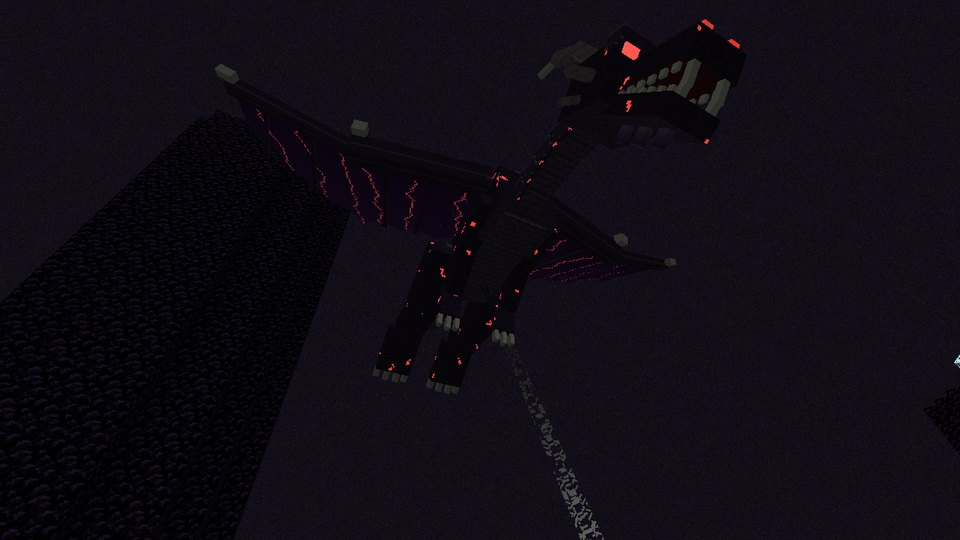

> Неофициальный фан-мод, не связан с Mojang и Microsoft. Код, модели, текстуры, интерфейс и синтезированные звуки сделаны для мода с нуля, звуковые эффекты с freesound.org — под лицензией CC0, голоса — синтез речи. Подробности в [CREDITS.md](CREDITS.md).

---

## Установка (5 минут)

1. **Установите Fabric Loader для 1.20.1.**
   - Официальный лаунчер: скачайте установщик с <https://fabricmc.net/use/installer/>, выберите версию **1.20.1**, нажмите «Install». В лаунчере появится профиль `fabric-loader-1.20.1`.
   - TLauncher и похожие: в списке версий выберите **Fabric 1.20.1** и установите.
2. **Скачайте мод** — файл `hardest-2.1.0.jar` со страницы *Releases* этого репозитория.
3. **Положите jar в папку `mods`** вашей игры. Для официального лаунчера и TLauncher это `%appdata%\.minecraft\mods` (если папки нет — создайте её).
4. **Fabric API отдельно ставить не нужно** — он уже встроен в jar мода. Если он у вас уже установлен, ничего страшного.
5. Запустите профиль **Fabric 1.20.1** и создайте **новый мир на выживании**. Лучше на сложности «Сложная» — мод для этого и сделан.

**Шейдеры.** Sodium можно ставить смело — он только ускоряет игру. С шейдерами Iris часть экранных эффектов (переворот экрана, «графика-картошка», глюки, серый экран смерти) не работает, так что для полного угара их лучше выключить.

Для мультиплеера мод должен стоять и на сервере (Fabric 1.20.1), и у всех игроков.

**Если что-то пошло не так**
- *Игра не запускается / мод не виден* — проверьте, что запускаете именно **Fabric 1.20.1** (не Forge и не 1.20.4) и что в `mods` лежит только один `hardest-*.jar`.
- *Нужна Java 17 или новее.* Официальный лаунчер и TLauncher ставят её сами.

---

## Что внутри

### Выживание

| Механика | Что происходит |
|---|---|
| **ДЕРЕВО ПАДАЕТ!** | Срубил нижнее бревно — всё дерево валится набок целиком, вместе с кроной. В половине случаев прямо на тебя. Присядь, чтобы рубить по-обычному |
| **Убегающая руда** | Алмазная руда в 60% случаев отращивает ноги и с криком убегает. Золото и изумруды — 35%, остальные руды — 15%. Догнал — двойной дроп |
| **Обвал** | Копаешь ниже y=48 — потолок может рухнуть. Секунда, чтобы отбежать |
| **Простуда** | Промок — простыл. Чихаешь так, что отбрасывает назад и выпадает предмет из рук. Лечится молоком, **бабушкиным чаем с малиной** или у костра |
| **Кричащая еда** | «Не ешь меня!», «У меня есть семья!» |
| **Платная кровать** | Сон стоит 1 алмаз. Бесплатно — только с **гусиной подушкой** в инвентаре |
| **Странные грибы** | Растут в мире и светятся. Очень сытные, но потом полминуты трипа: экран вверх ногами, перепутанные кнопки, вертикальный ТикТок, «графика-картошка», невесомость, ТУРБО или лаги |
| **ПОТРАЧЕНО** | Экран смерти как в GTA: мир становится серым и падает огромная надпись |

### Мобы стали злее
- **Все враждебные мобы** получили +25% здоровья и +20% урона.
- **Зомби-строители** в жёлтых касках ставят блоки, чтобы до тебя добраться. Столб не спасёт.
- **Скелеты-снайперы**: красный лазерный прицел, потом очень больной выстрел.
- **Криперы-прыгуны** прыгают на тебя с 3–9 блоков.
- **Пауки** плюются паутиной.
- **Эндермены** при ударе могут утащить тебя телепортом.
- **Ведьмы**: их зелья с шансом 50% дают ещё и трип.
- **Гасты** иногда стреляют сразу тремя шарами.
- **Гуси** подкрадываются и вырывают предмет прямо из руки. С них падают перья для подушки.
- **Мимики**: каждый третий сундук в данжах и деревнях кусается.

### События мира

| Событие | Когда |
|---|---|
| **Налоговая проверка** | Раз в 25–40 минут. Инспектор забирает **13% от всего**. **Квитанция об уплате** спасает от одной проверки |
| **Доставка** | Раз в 20–35 минут крипер-курьер приносит посылку… и взрывается. Внутри что угодно: алмазы, тапок, 10 куриц, два крипера, наковальня на голову, гусь |
| **Реклама** | Раз в 15–25 минут — неубираемая реклама на 13 секунд. Кнопка «Пропустить» убегает от мыши. Игра НЕ на паузе |
| **Капча** | Перед столом зачарований, наковальней, эндер-сундуком, варочной стойкой и столом кузнеца. Ошибся — молния |
| **Коровопад** | Иногда вместо дождя идут коровы на парашютах. Без парашюта — больно |
| **Наковальнепад** | В грозу с неба падают наковальни. Красная метка показывает, куда |
| **Кровавая луна** | Каждую третью ночь: красное небо, вдвое больше мобов, спать нельзя. Ночью приходит **двойник** с твоим скином и оружием |
| **Загрузка Незера / Края** | При первом входе — «Загружаем Незер… не выключайте компьютер». Пока грузится, стоишь как вкопанный |
| **Лаги в Незере** | «Пинг 999»: тебя откидывает назад. Особенно приятно у лавы |

<p>
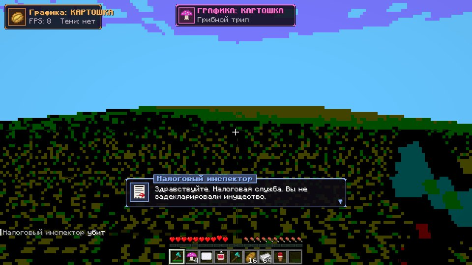
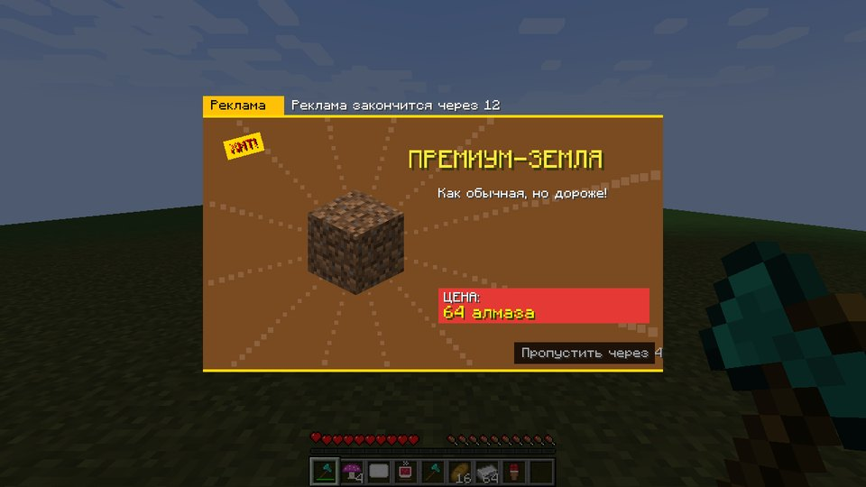
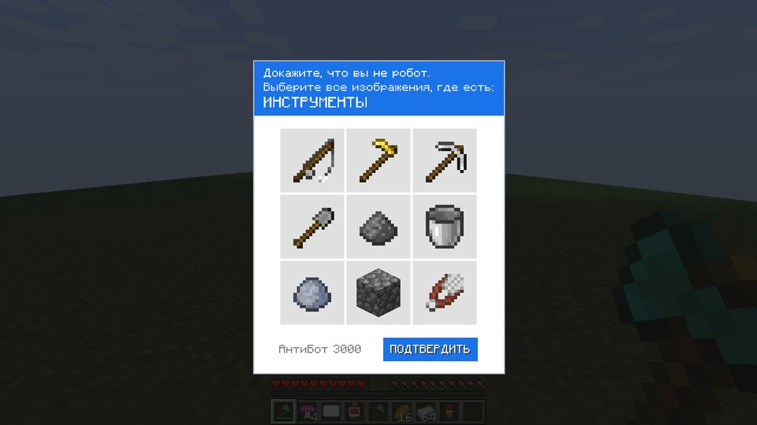
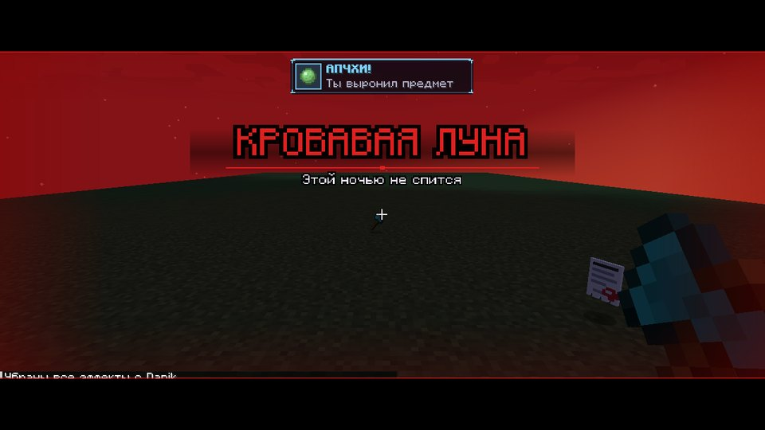
</p>

### Финал: Пробуждённый Эндер-дракон

Новая модель, собранная в Blender (исходник — [`extras/blender/ender_dragon_2.blend`](extras/blender/ender_dragon_2.blend)): рога, клыки, светящиеся глаза, кристаллы сквозь чешую, рваные крылья и хвост с клинком. Дракон **вдвое больше** ванильного, хитбоксы тоже. Каждый взмах крыльев трясёт экран, при рёве пасть раскрывается.

- **500 HP** вместо 200, три фазы, своя музыка, своя полоса здоровья.
- **Атаки идут по одной**, у каждой есть предупреждение. Пока дракон сидит на портале, атак меньше — это окно, чтобы бить в голову.
- **Фаза 1:** метеоритный дождь (красные метки), **пикирование** с ударной волной (её надо перепрыгнуть), **рёв** — сначала вдох, потом сносит всех вокруг (держи щит).
- **Фаза 2 (60%)** — катсцена, кристаллы снова загораются на столбах. Добавляются **кристальные шипы** из земли, **вихрь Пустоты**, рои эндермитов и **гусиный десант**.
- **Фаза 3 (30%)** — туман Края наливается кровью. **Гигантский метеорит**, **коровья бомбардировка**, **лазер Пустоты**, сбой гравитации, иногда две атаки сразу.

<p>
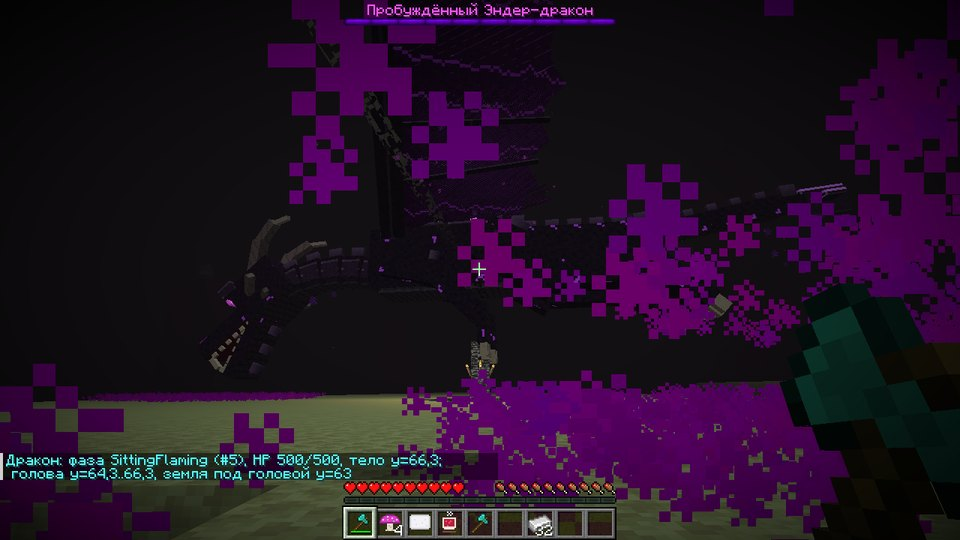
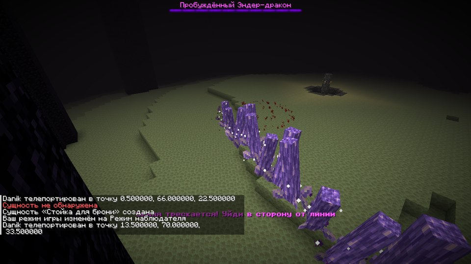
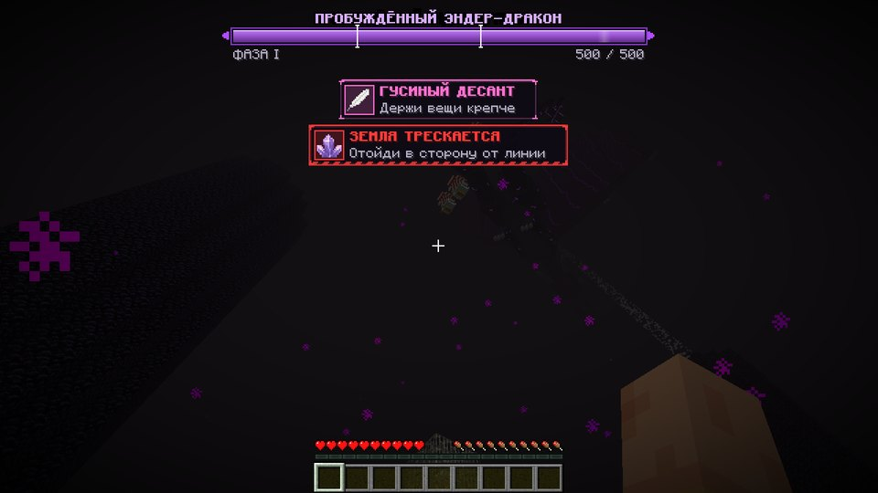
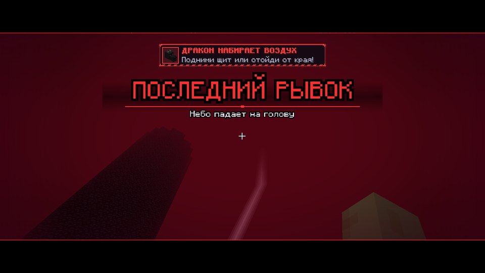
</p>

### Предметы

| Предмет | Рецепт | Зачем |
|---|---|---|
| **Драконобой 9000** | алмаз + око Края / алмаз, арбалет, алмаз / железный блок + алмаз (по диагонали) | Зажми ПКМ — очередь лучей, почти 7 выстрелов в секунду. Дракону −2 HP за попадание, дальность 128 блоков, автоприцел. Не замедляет при стрельбе |
| Мамин тапок | 6 кожи + нитка (`.L.` / `LSL` / `LLL`) | ПКМ — бросок-бумеранг, крит с голосом мамы, ×3 урона по дракону |
| Гусиная подушка | 3 гусиных пера сверху, 3 белой шерсти снизу | Спать без оплаты алмазом |
| Бабушкин чай с малиной | пузырёк + 2 сладкие ягоды + сахар | Лечит простуду |
| Клавиша Ctrl+Z | редстоун по углам, гусиные перья по сторонам, алмаз в центре | Отменяет одну смерть: VHS-перемотка на 5 секунд назад |
| Квитанция об уплате налога | с налогового инспектора | Спасает от одной налоговой проверки |
| Горячая картошка | из посылок | Взорвётся через 30 секунд. Ударь ей моба, чтобы передать |

Рецепт Драконобоя на верстаке:

| | | |
|---|---|---|
| — | Алмаз | Око Края |
| Алмаз | Арбалет | Алмаз |
| Железный блок | Алмаз | — |

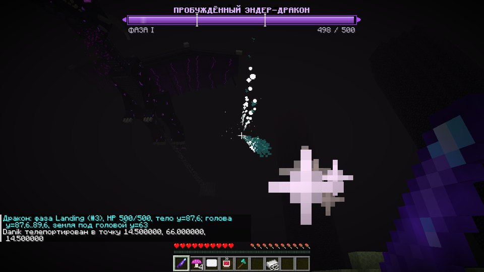

### Интерфейс
- **Плашки сверху экрана** вместо строки над хотбаром: иконка, что случилось и что делать. Красные мигающие — «сейчас прилетит».
- **Большие заголовки** событий, у босса и Кровавой луны — с кинополосами.
- **Реплики персонажей** в рамке с портретом и табличкой имени, текст печатается.
- **Экраны загрузки, лаги, Ctrl+Z (VHS-перемотка), ТикТок, «картошка»** — всё в одном стиле.

<p>
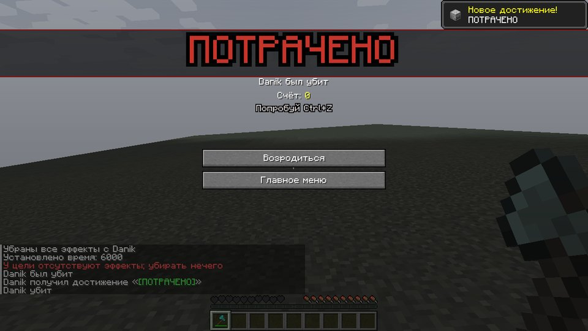
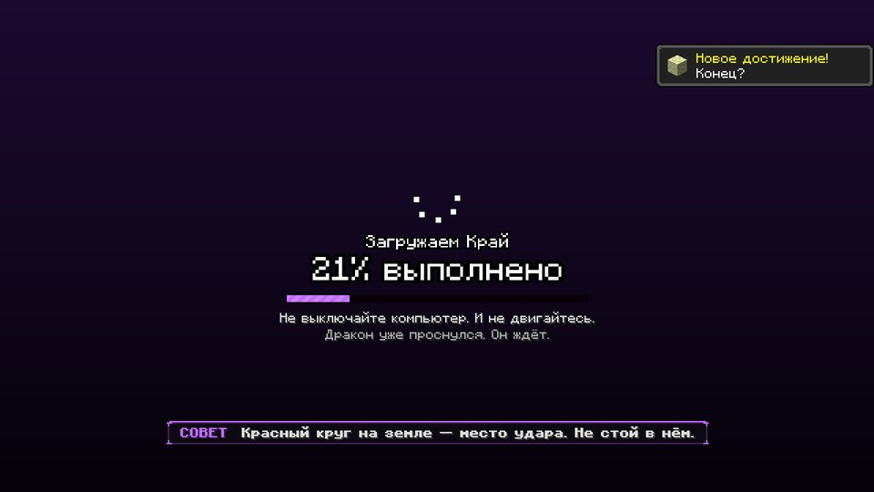
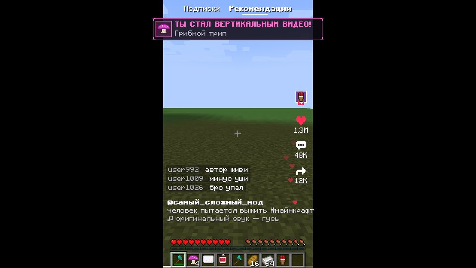
</p>

### Достижения
23 шуточных достижения: «ДЕРЕВО!», «Будь здоров», «Грибной трип», «Обвал», «Гусь-грабитель», «Налоговый резидент», «Я робот», «ПОТРАЧЕНО», «Кровавая луна», «Он проснулся» и **«Самый сложный мод пройден»** — испытание за дракона.

---

## Команды (нужны читы)

| Команда | Что делает |
|---|---|
| `/hard event tax` | Налоговая проверка сейчас |
| `/hard event courier` | Курьер с посылкой |
| `/hard event ad` | Реклама |
| `/hard event cowfall` / `anvils` | Коровопад / наковальнепад |
| `/hard event bloodmoon` | Кровавая луна прямо сейчас |
| `/hard event lag` | Лаг-спайк |
| `/hard event loading_nether` / `loading_end` | Загрузочный экран |
| `/hard event cavein` | Обвал над головой |
| `/hard event cold` / `sneeze` | Простудить / чихнуть |
| `/hard trip <id>` | Трип: australia, inverted, tiktok, potato, float, turbo, lag, glitch |
| `/hard dragon <атака>` | В Крае: meteors, roar, dive, spikes, vortex, bigmeteor, shockwave, swarm, geese, cows, laser, crystals |
| `/hard dragon phase2` / `phase3` | Сразу перейти к фазе (с катсценой) |
| `/hard dragon perch` | Посадить дракона на портал |
| `/hard fx <эффект> <сек>` | Любой экранный эффект |
| `/hard timers` | Сколько осталось до налоговой, курьера и рекламы |
| `/give @s hardest:dragon_cannon` | Выдать Драконобой |

---

## Сборка из исходников

Нужен JDK 17 или новее:

```bash
./gradlew build                 # jar появится в build/libs/
```

Ассеты собираются скриптами в `tools/` (Python 3, Pillow, numpy, scipy, ffmpeg, edge-tts):

```bash
python3 tools/gen_models.py      # модели мобов и дракона -> ModelDefs.java
python3 tools/gen_textures.py    # пиксель-арт текстуры
python3 tools/gen_voice.py       # реплики (edge-tts + ffmpeg)
python3 tools/gen_synth.py       # синтезированные звуки и музыка дракона
python3 tools/gen_assets.py      # sounds.json, языки, рецепты, достижения, модели предметов
```

- Модель дракона экспортируется из Blender в `tools/dragon_model.json`, генератор моделей превращает её в Java-код.
- CC0-звуки скачивает и нарезает `tools/fetch_sfx.py` + `tools/process_sfx.py` по списку `tools/sfx_sources.txt`.
- Визуальная проверка: `./gradlew runAutotest` запускает игру по сценарию `run/autotest.txt` (команды `cmd`, `wait`, `shot`, `lookat`, `press` …) и сохраняет скриншоты в `run/screenshots`.

GitHub Actions собирает мод на каждый пуш, а при изменении `.github/release-version` публикует релиз с jar.
